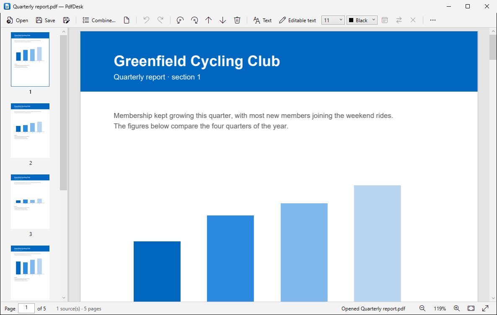
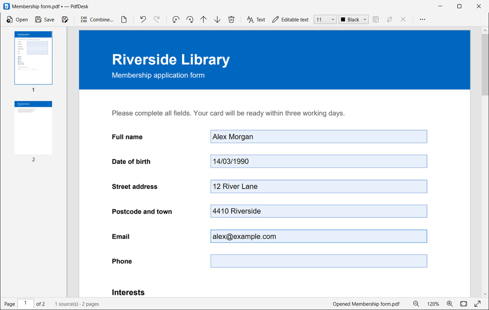
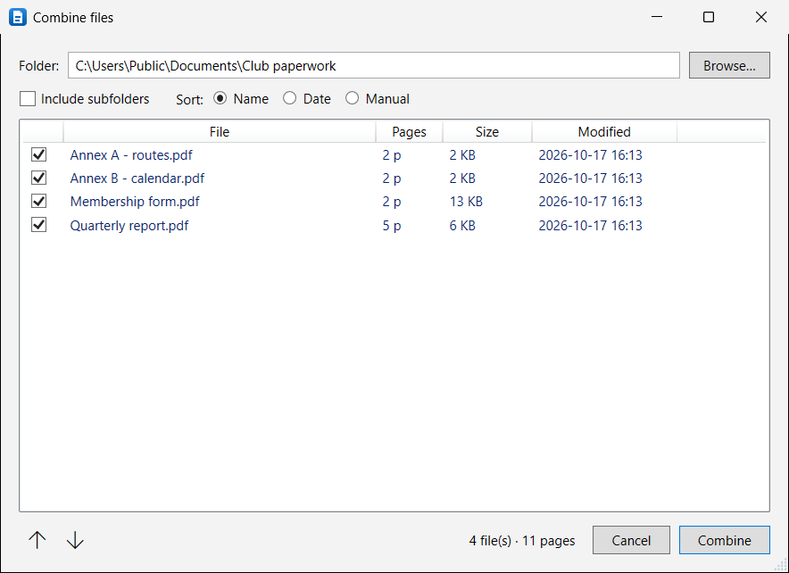

# PdfDesk

A small, fast Windows app for everyday PDF chores: view, reorder, combine, and fill in forms.
Nothing leaves your PC, and nothing is written until you click **Save**.

[](https://github.com/Miguel897/pdfdesk/actions/workflows/ci.yml)
[](https://github.com/Miguel897/pdfdesk/releases/latest)
[](LICENSE)



- **View** PDFs with smooth continuous scrolling, zoom and thumbnails.
- **Reorder** pages by dragging thumbnails (multi-select with Ctrl/Shift), **rotate** and **delete** pages, with undo/redo.
- **Combine** the PDFs of a folder: tick files, sort by name (`2` before `10`), date or by hand, then fine-tune page by page before saving.
- **Insert** pages from other PDFs by dropping files onto the thumbnail strip.
- **Fill in forms**:
  - **Text** draws typed text into the page (looks the same in every viewer).
  - **Editable text** saves it as a standard annotation that Acrobat, Edge, etc. can still move and edit.
  - Fillable PDFs: text fields and checkboxes are highlighted and can be typed into or ticked.
- Opens password-protected PDFs (asks for the password).

| Fill in forms | Combine the PDFs of a folder |
|---|---|
|  |  |

The screenshots use fictional sample documents.

## Download

Get `PdfDesk.exe` from the [latest release](https://github.com/Miguel897/pdfdesk/releases/latest).
It is a single self-contained file: no installer, no .NET install, no admin rights.

Requirements: Windows 10/11 x64.

The exe is not code-signed, so SmartScreen may warn on first start (**More info › Run anyway**).

### Open PDFs from Explorer

In PdfDesk: **⋯ › Show PdfDesk in "Open with"**. Then in Explorer right-click a PDF ›
**Open with › Choose another app › PdfDesk** and tick **Always** if you want it as the default.
This is registered for your user only (no admin). If you move `PdfDesk.exe`, use the menu item again.

## Using it

| Action | How |
|---|---|
| Open | Ctrl+O, drop a PDF on the window, or Explorer "Open with" |
| Save / Save as a copy | Ctrl+S / Ctrl+Shift+S (a combined document asks for a name on first save) |
| Undo / Redo | Ctrl+Z / Ctrl+Y |
| Move pages | Drag thumbnails, or Alt+↑ / Alt+↓ |
| Rotate / delete pages | Toolbar buttons, Del (selected pages, or the current page) |
| Add pages from other PDFs | Drop files onto the thumbnail strip at the wanted position, or drop them on the page to append |
| Text tool / Editable text tool | T / Shift+T, then click on a page and type. Esc finishes |
| Move a text box | Drag the blue handle on its left |
| Navigate | PgUp / PgDn, Home / End, or type a page number in the status bar |
| Zoom | Ctrl+wheel, Ctrl+plus / Ctrl+minus, Ctrl+0; fit width / fit page in the status bar |

Good to know:

- Save writes to a temporary file first and then replaces the target, so a failed save never damages the file.
- Saving a document that came from one file keeps its form fields, bookmarks and metadata. A combined
  document is assembled page by page: filled-in values stay visible, but form fields are no longer
  interactive and bookmarks are dropped.
- Saved copies of password-protected PDFs are not password-protected.
- Typed text stays editable in PdfDesk until you close the document, even after saving.

## Privacy

PdfDesk works entirely offline. It has no telemetry, makes no network connections and needs no
account. Your files never leave your PC. The only things it writes besides your PDFs are listed below.

## Where data is stored

| What | Where |
|---|---|
| Settings (window, recent files, text defaults) | `%APPDATA%\PdfDesk\settings.json` |
| Log (7 days) | `%LOCALAPPDATA%\PdfDesk\logs` (⋯ › Open log folder) |
| "Open with" registration | `HKCU\Software\Classes\PdfDesk.pdf`, `HKCU\Software\Classes\Applications\PdfDesk.exe` |

## Build

Requires the .NET 10 SDK.

```powershell
dotnet build PdfDesk.slnx
dotnet test PdfDesk.slnx
dotnet run --project src/PdfDesk.App -- "C:\path\file.pdf"

# Single self-contained exe in .\publish (~66 MB)
dotnet publish src/PdfDesk.App -c Release -r win-x64 -o publish
```

Package versions are pinned centrally in `Directory.Packages.props` and locked in `packages.lock.json`
(CI restores in locked mode). After changing a package, run `dotnet restore --force-evaluate`.

### Releasing

The version comes from git tags ([MinVer](https://github.com/adamralph/minver)); there is no version
number to edit. Untagged builds get a pre-release version such as `0.1.2-alpha.0.3`.

1. In [CHANGELOG.md](CHANGELOG.md), rename **Unreleased** to the new version and date (in a PR).
2. Tag that commit on `main` and push the tag: `git tag v1.0.0 && git push origin v1.0.0`.

The release workflow tests, publishes `PdfDesk.exe` and creates the GitHub release. The release notes
are the version's CHANGELOG section followed by GitHub's generated list of PRs (dependency bumps
excluded). Tags with a suffix such as `v1.1.0-beta.1` become pre-releases.

## Project layout

```
src/PdfDesk.Core      document model, PDFium interop (rendering), PDFsharp export, combine, settings
src/PdfDesk.App       WPF app (MVVM): main window, combine dialog, Open-with registration
tests/PdfDesk.Core.Tests  xUnit; test PDFs are generated in code
docs/PRD.md           requirements and design decisions
```

Rendering uses [PDFium](https://pdfium.googlesource.com/pdfium/) (Chrome's PDF engine, via
`bblanchon.PDFium.Win32`); writing uses [PDFsharp](https://www.pdfsharp.com/). Both are permissively licensed.

## License

MIT, see [LICENSE](LICENSE).

PdfDesk.exe bundles PDFium, PDFsharp, CommunityToolkit.Mvvm and the .NET runtime. Their licenses are
in [THIRD-PARTY-NOTICES.txt](THIRD-PARTY-NOTICES.txt), also shown in the app under **⋯ › About PdfDesk**.
